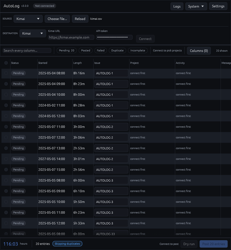

<div align="center">
  <a href="https://github.com/BishrGhalil/AutoLog">
    
  </a>
  <h1>AutoLog</h1>
  <p>
    Reads a worklog export from wherever you track your time, and posts every entry to wherever it has to be logged.
  </p>
  <a href="https://github.com/BishrGhalil/AutoLog/releases/latest">
    
  </a>
  <a href="https://github.com/BishrGhalil/AutoLog/releases/latest">
    
  </a>
  <a href="https://github.com/BishrGhalil/AutoLog/releases/">
    
  </a>
  <a href="https://github.com/BishrGhalil/AutoLog/blob/main/LICENSE">
    
  </a>
</div>

## About

AutoLog is built around two sides:

- **Providers** are where the entries come from: a CSV or spreadsheet export from **Grindstone**, **Kimai** or **Odoo**.
- **Consumers** are where the entries go: **Jira** or **Kimai**.

Pick one of each, point AutoLog at the file, review the table, and press Post. Nothing leaves your machine until you do.



This is the Rust rewrite of AutoLog, replacing the Python and Tk version. It is a single executable with nothing to install
alongside it, it posts entries in parallel rather than one at a time, and it shows every column your export has rather than
only the handful it needs.

## Install

Download the executable for your platform from the [releases page](https://github.com/BishrGhalil/AutoLog/releases).

- **Windows** — `autolog.exe`. Signed; no runtime to install.
- **Linux** — `autolog`. Needs a desktop with OpenGL, which any normal install has. Mark it executable with `chmod +x autolog`.

You can also open an export with AutoLog directly: `autolog path/to/export.csv`.

## Using it

### Loading a file

Choose your provider, then drop the export onto the window or press **Choose file**. AutoLog reads `.csv`, `.tsv`, `.xlsx`,
`.xlsm`, `.xls` and `.ods`, sniffs comma, semicolon and tab separators, and copes with the byte-order mark spreadsheets
like to write.

Rows it cannot read — a date it does not recognise, a length that is not a length — are listed rather than quietly dropped.

Every column in the file is kept. Use the **Columns** menu to show any of them beside the ones AutoLog always shows, and the
choice is remembered per provider.

### Connecting

Fill in the credentials for your tracker and press **Connect**.

- **Jira** needs your site address, your account email and an [API token](https://support.atlassian.com/atlassian-account/docs/manage-api-tokens-for-your-atlassian-account/#Create-an-API-token).
- **Kimai** needs your site address and an API token from *User profile → API*.

Tokens go to your operating system's credential store — Windows Credential Manager, or the Secret Service on Linux. They are
never written to the settings file. Everything else you pick, including which consumer you used last, comes back the next
time you open AutoLog.

If no credential store can be reached, AutoLog says so and keeps the tokens for that session only, rather than writing them
somewhere it controls. A store that exists but will not answer — a Linux keyring nobody has unlocked yet, most often — is
reported as a warning rather than read as an empty one, so a token you still have is never saved over.

To see what your machine's credential store is doing:

```bash
cargo run -p autolog-core --example keyring_check
```

It writes, reads back and deletes one throwaway entry, then reports whether each tracker's token is present. Values are
never printed.

### Deciding where each entry goes

Each tracker declares the destinations it needs, and AutoLog guesses them from the entry's work item.

- **Jira** needs a project and an issue. Both are fetched on connect — the projects you can see, and the issues you are
  assigned to or have already logged against — and matched against the work item, which usually carries the key in a shape
  like `ABC-123`, `[ABC-123]` or `[ABC] 123`. Issues are narrowed to the project you chose. An issue the search did not
  return can still be typed straight into the picker.
- **Kimai** needs a project and an activity. Activities are narrowed to the project you chose, so changing a row's project
  re-matches its activity underneath.

Changing a row's project carries its issue or activity with it, rather than leaving a destination that contradicts the
column beside it.

How hard AutoLog tries is **set per field**, in Settings:

| Strategy | What it accepts |
| --- | --- |
| **Manual** | Nothing. Every row waits for you. |
| **Exact** | Only a name that reads identically once case and punctuation are set aside. |
| **Contains** | That, or one name appearing whole inside the other. |
| **Similar** | That, plus the closest name that scores above the threshold. |

**Projects match on Contains** by default, so a work item that names the project anywhere in its text finds it. An
**activity or issue is matched loosely**, because both are free text somebody typed twice. Tighten a field to Exact, or turn
it off with Manual, in Settings — every row is matched again when you do.

Names that differ only in their numbers are never paired, whatever the strategy, so an entry on `ABC-6061` will not quietly
land on an `ABC-6055` activity.

Anything AutoLog could not work out keeps the text it was matching against, coloured so it stands out, with a tooltip
saying what it looked for. Those rows are refused at posting time rather than guessed at.

### Reviewing

- **Search** looks at every column, including the ones from your file.
- **Filter chips** narrow the table to one status.
- **Click a cell** to change where that row goes. A destination opens a searchable list: start typing and it filters
  straight away, with no need to click into the filter box first.
- **Select rows** with the checkboxes, then use the pickers in the toolbar to set a destination on all of them at once.
  With nothing selected, those pickers apply to everything currently on screen.
- Sort by any column by clicking its heading.

### Posting

**Dry run** checks every entry against the tracker without sending anything, and marks what is incomplete.

**Post** sends everything not already posted. Entries go out several at a time, under a rate limit you can set, and each row
updates as it settles. **Stop** ends the run after the entries already in flight; it never leaves a half-posted entry,
because each entry is one request.

With **duplicate checking** on — the toggle sits on the bottom bar, beside the total — AutoLog reads back what the tracker
already has and skips anything with the same start, length and comment. A failed row can be fixed and posted again — anything already posted is left alone.

Errors say what happened and what to do about it, with the technical detail behind a disclosure and a link to the log folder.

## Development

```bash
cargo run -p autolog-gui            # or: cargo run -p autolog-gui -- samples/grindstone.csv
cargo test --workspace
cargo clippy --workspace --all-targets
cargo fmt --all
```

The workspace is two crates:

- **`autolog-core`** — the rules, with no knowledge of a window: reading files, matching names, talking to trackers, and
  the posting pipeline. This is where the tests are.
- **`autolog-gui`** — the window, built with [egui](https://github.com/emilk/egui). State changes only on the painting
  thread; slow work runs on a Tokio runtime and reports back between frames.

### Adding a provider

Providers are data. Add a `ProviderSpec` to `PROVIDERS` in [`crates/autolog-core/src/source/spec.rs`](crates/autolog-core/src/source/spec.rs),
naming the columns and how that vendor writes a duration. There is no trait to implement and nothing else to touch.

```rust
ProviderSpec {
    id: "toggl",
    label: "Toggl",
    about: "CSV export with Description, Start date, Start time and Duration columns.",
    started: &["Start date", "Start time"],
    default_time: None,
    duration: "Duration",
    duration_format: DurationFormat::Clock,
    description: "Description",
    activity: "Description",
    issue_source: "Description",
    date_order: DateOrder::Auto,
}
```

### Adding a consumer

Write a `ConsumerSpec` declaring the credentials it needs and the destination fields each entry must be given, then
implement [`Consumer`](crates/autolog-core/src/consumer/mod.rs) for the parts that are genuinely its own: signing in,
listing its names, reading back what is already logged, and posting one entry.

Guessing which name an entry belongs to is not one of those parts. It is handled once, for every consumer, from the hints
and strategy the spec declares — so a new tracker gets matching, bulk editing, per-field strategies and its row in the
Settings panel without writing any of them. Register it in `CONSUMERS` and `build`.

## Roadmap

- [x] Windows executable, code signed
- [x] Kimai as a logging target
- [x] Parallel posting with a rate limit
- [x] Per-field matching strategies
- [x] Every source column in the table
- [ ] A command-line mode for unattended runs

## Contributing

Contributions are welcome. Please fork the repo and open a pull request.

## License

MIT. See [`LICENSE`](LICENSE).
